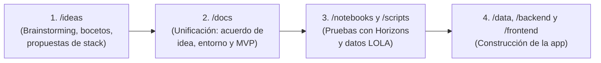

# 🧭 Manual de Organización del Repositorio — Lunáticos 2026

Este manual explica **qué guardar en cada carpeta del repositorio**, especialmente ahora que estamos en la **Fase 1 (Definición de idea, proyecto, entorno y herramientas)** y cómo evolucionará cuando pasemos a la **Fase 2 (Construcción del MVP)**.

---

## 🗺️ Mapa Rápido: "¿Dónde guardo esto?"

| ¿Qué tenés en la mano? | ¿En qué carpeta va? | Ejemplo de archivo |
| :--- | :--- | :--- |
| Una lluvia de ideas, propuesta de pantalla, comparativa de frameworks o nota personal antes de decidir en equipo | **`/ideas`** | `ideas/idea-sguenio-ui.md`, `ideas/propuesta-stack.md` |
| Una decisión ya tomada por el equipo (stack elegido, arquitectura, reglas del negocio, estado de MCPs, guías) | **`/docs`** | `docs/arquitectura-definida.md`, `docs/alcance-mvp.md` |
| Una prueba rápida en código/Python para ver cómo responde la API de JPL Horizons o cómo leer un mapa LOLA | **`/notebooks`** | `notebooks/01-prueba-horizons.ipynb` |
| Un script que descarga datos automáticamente o transforma un mapa pesado en un JSON liviano | **`/scripts`** | `scripts/descargar_efemerides.py` |
| Listas de sitios de alunizaje (JSON/CSV) o datos ya limpios y livianos listos para usar en la app | **`/data`** | `data/sitios-polo-sur.json` |
| Archivos gigantes descargados de la NASA (GeoTIFF de LOLA, tablas crudas pesadas) que **no** deben subir a GitHub | **`/data/raw`** *(ignorado por Git)* | `data/raw/lola_south_pole.tif` |
| El servidor / API que calcula la elevación del Sol y de la Tierra sobre el horizonte real | **`/backend`** | `backend/app/main.py` |
| La interfaz web, el comparador lado a lado, líneas de tiempo y gráficos 2D/3D | **`/frontend`** | `frontend/src/App.tsx` |

---

## 🔄 Flujo de Trabajo según la Fase del Hackathon

### Fase 1: Definición (¡Estamos acá! 📍)
En esta etapa todavía estamos definiendo qué vamos a hacer exactamente y con qué herramientas:
1. **Todo borrador o propuesta va a `/ideas`:**
   - Usá la plantilla [ideas/PLANTILLA-PROPUESTA.md](../ideas/PLANTILLA-PROPUESTA.md).
   - Subí ahí tus propuestas de diseño, posibles librerías 2D/3D, enlaces de referencia, prompts o análisis del problema.
2. **Cuando el equipo se pone de acuerdo, pasa a `/docs`:**
   - Una vez que unifiquemos criterios (por ejemplo: *"Usamos React + FastAPI, comparamos 5 sitios del polo sur con datos precomputados"*), creamos el documento oficial en `/docs` para que todo el equipo siga esa misma línea.

### Fase 2: Exploración Técnica y Datos
1. **`/notebooks`:** Para experimentar sin miedo a romper nada. Acá probamos cómo pedirle a JPL Horizons la posición del Sol y la Tierra desde el polo sur lunar y cómo calcular el horizonte con LOLA.
2. **`/scripts`:** Cuando el código de un notebook funciona, lo pasamos a un script limpio en `/scripts` para preprocesar los datos.
3. **`/data` vs `/data/raw`:**
   - Todo archivo crudo o pesado (>10 MB) va en `data/raw/` (Git lo ignora automáticamente para no bloquear el repo).
   - Los archivos procesados y livianos (JSON/CSV con los sitios curados de Apollo/CLPS y perfiles de horizonte) van en `/data`.

### Fase 3: Desarrollo de la Aplicación
1. **`/backend`:** Contiene la API o motor de cálculo que recibe `(sitio, fecha_hora)` y devuelve la posición del Sol, posición de la Tierra, perfil del horizonte, tiempo hasta el ocaso y ventanas de comunicación.
2. **`/frontend`:** Contiene la interfaz visual para expertos, docentes y público general (comparador lado a lado, selector de fechas, visualización 2D/3D del horizonte y métricas).

---

## 🛠️ Reglas de Oro para no pisarnos en Git

1. **En la fase de `/ideas`:** Nombrá tus archivos incluyendo tu nombre o iniciales (ej. `ideas/propuesta-luciano.md` o `ideas/propuesta-sguenio.md`). Así nunca habrá conflictos de merge.
2. **Ramas:** Usá ramas `feat/<nombre>` (por ejemplo `feat/ideas-iniciales` o `feat/definicion-stack`) como indica [CONTRIBUTING.md](../CONTRIBUTING.md).
3. **Secretos y claves:** Nunca guardes tokens ni contraseñas en ninguna carpeta; usá siempre un archivo `.env` local basado en [.env.example](../.env.example).
